# bunact architecture

This document describes how [`src/bunact.ts`](https://github.com/janfeshanm/bunact/blob/main/src/bunact.ts) works: its modules, its data structures, how data moves through it, and how Bun turns TSX into a running page.

The whole framework is one TypeScript file of about 350 lines with no runtime dependencies. It has two halves:

- **A reactivity core.** Signals hold values. Effects re-run when the signals they read change.
- **A renderer.** It builds real DOM nodes from JSX and wires each dynamic piece directly to the signals it depends on. There is no virtual DOM and no diffing of component trees.

Contents:

1. [Big picture](#1-big-picture)
2. [Toolchain: how Bun builds and serves](#2-toolchain-how-bun-builds-and-serves)
3. [Module map](#3-module-map)
4. [Data model](#4-data-model)
5. [Reactivity core](#5-reactivity-core)
6. [Ownership and cleanup](#6-ownership-and-cleanup)
7. [Renderer](#7-renderer)
8. [Control flow: Show and For](#8-control-flow-show-and-for)
9. [End-to-end example: one click](#9-end-to-end-example-one-click)
10. [Design decisions and limitations](#10-design-decisions-and-limitations)
11. [API reference](#11-api-reference)

---

## 1. Big picture

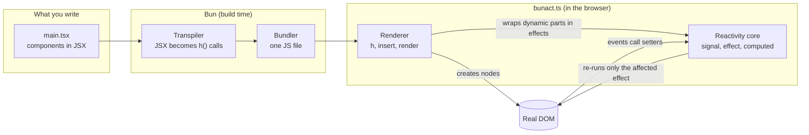

The key idea is **components run once**. A component function builds DOM nodes and returns them. After that, the only code that ever runs again is the small effects attached to individual text nodes and attributes. When a signal changes, bunact does not re-render the component. It updates the exact text node or attribute that reads that signal.

---

## 2. Toolchain: how Bun builds and serves

Bun is the only tool. It runs TypeScript directly, transpiles JSX, bundles, serves, and hot-reloads.

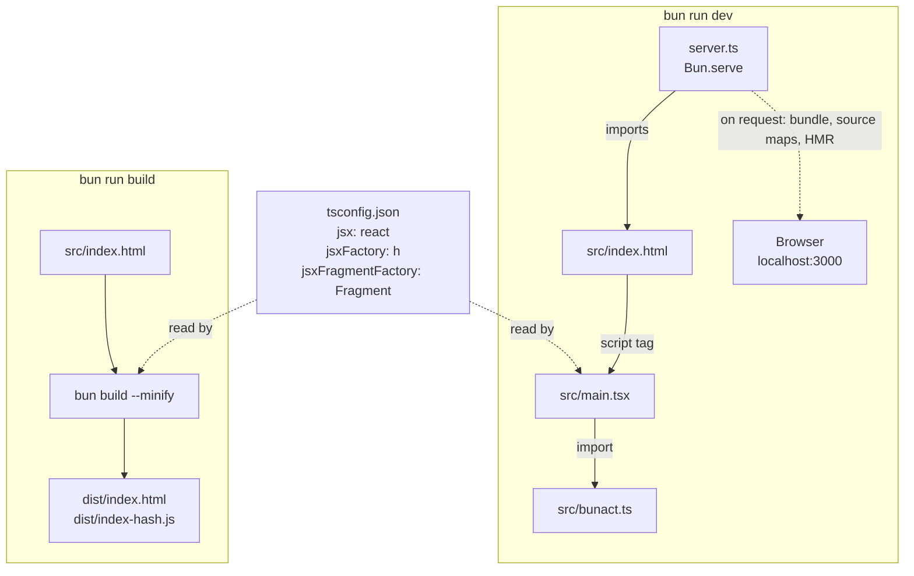

`tsconfig.json` sets `"jsx": "react"` with `jsxFactory: "h"`. Both TypeScript and Bun's transpiler read it, so this JSX:

```tsx
<p class="x">{count}</p>
```

compiles to:

```ts
h("p", { class: "x" }, count);
```

That is why every file that uses JSX imports `h` and `Fragment` from `bunact.ts`, and why the framework file itself is plain `.ts`: it contains no JSX, it only *implements* the JSX factory.

| File | Extension | Why |
| --- | --- | --- |
| `src/bunact.ts` | `.ts` | Implements `h()`. Contains no JSX syntax. |
| `src/main.tsx` | `.tsx` | Uses JSX syntax, which TypeScript only allows in `.tsx`. |
| `server.ts` | `.ts` | Server code, no JSX. |

---

## 3. Module map

The file is organized in four sections. Arrows mean "calls" or "uses".

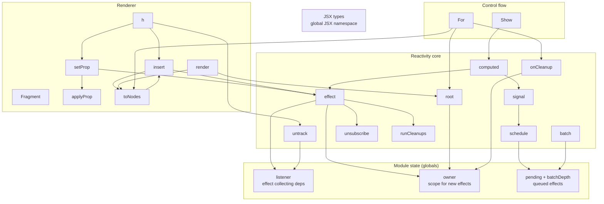

---

## 4. Data model

bunact has very few data structures. A signal is just a closure; it is not an object.

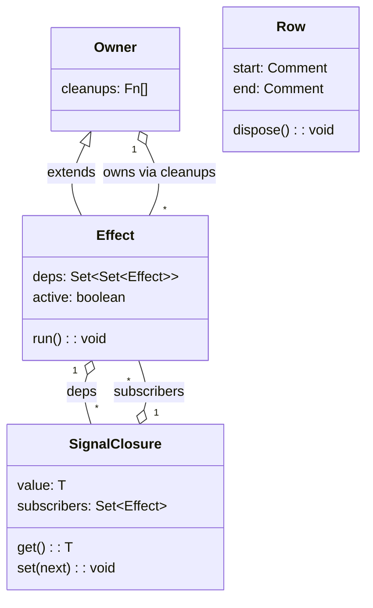

| Structure | Where | Holds |
| --- | --- | --- |
| `Owner` | any scope: an effect, a `root()`, a `For` row | `cleanups`: functions to run when the scope is disposed or re-run. Child effects register their `dispose` here. |
| `Effect` | created by `effect()` | `run`: re-executes the user function. `deps`: every subscriber set it is in, so it can unsubscribe itself. `active`: false once disposed. |
| Signal closure | created by `signal()` | `value` and `subscribers` captured in a closure. |
| `Row` | inside `For` | Comment markers that bracket one row's DOM nodes, plus the row's `dispose`. |

The subscription link is **two-way**. A signal knows its effects (so `set` can notify them), and an effect knows the subscriber sets it belongs to (so it can remove itself before each re-run).

### Module state

| Global | Purpose |
| --- | --- |
| `listener` | The effect currently running. Signal reads subscribe it. `null` means "do not track". |
| `owner` | The scope that new effects and cleanups attach to. |
| `batchDepth` | How many `batch()` calls are open. Above 0, effects are queued instead of run. |
| `pending` | The queue of effects waiting for the outermost `batch()` to finish. |

`listener` and `owner` are separate on purpose. `untrack()` turns off tracking but keeps ownership, so effects created inside a component body are still cleaned up with their parent.

---

## 5. Reactivity core

### 5.1 Dependency tracking (reads)

Tracking is automatic. While an effect runs, it is stored in `listener`. Any signal read during that time adds the effect to its subscribers.

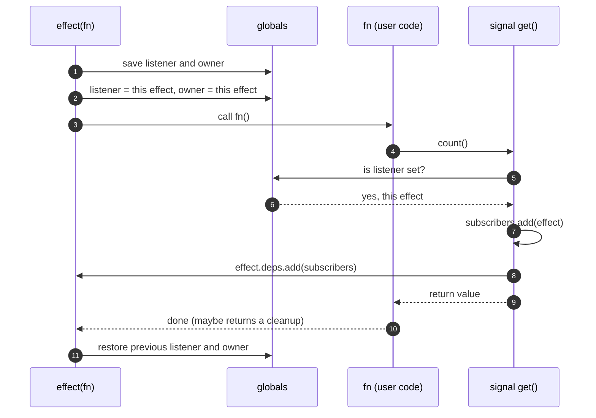

Dependencies are **re-collected on every run**. Before re-running, the effect unsubscribes from everything, so if a branch stops reading a signal, that signal no longer triggers it:

```ts
effect(() => {
  if (showDetails()) console.log(details()); // details is tracked only while showDetails() is true
});
```

### 5.2 Update propagation (writes)

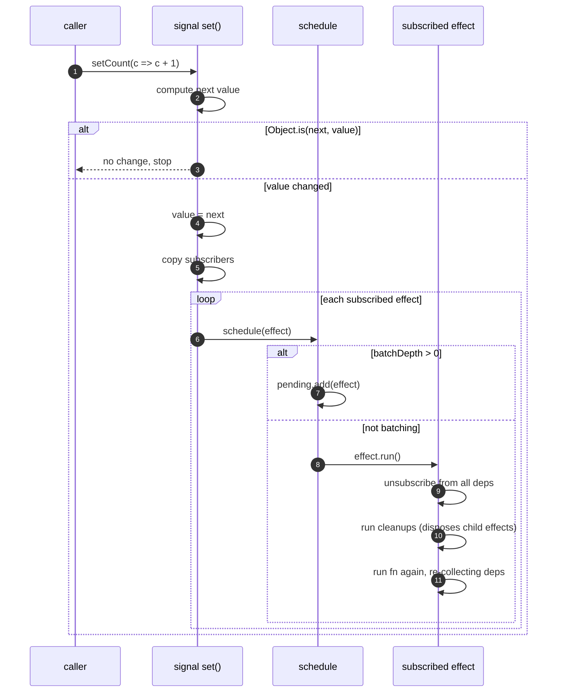

The subscriber set is copied before the loop because each effect removes itself and re-subscribes during its own run. Iterating the live set would loop forever.

### 5.3 Effect lifecycle

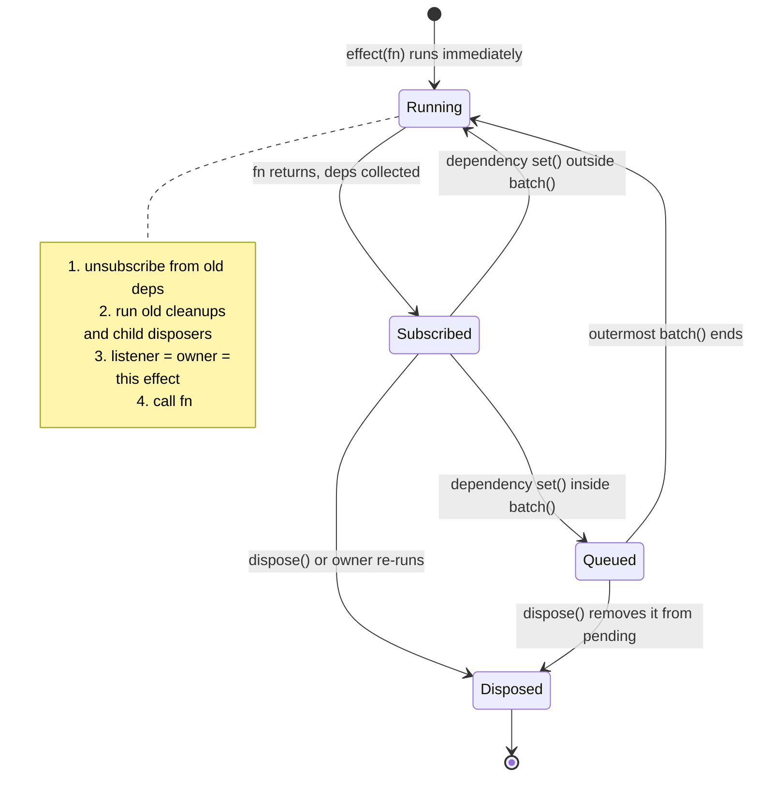

### 5.4 computed

`computed(fn)` is a signal plus an effect that writes into it:

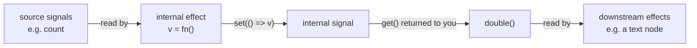

The internal `set(() => v)` uses the updater form so a computed value can itself be a function without being misread as an updater. Because `set` skips unchanged values (`Object.is`), downstream effects only run when the derived value actually changes.

### 5.5 batch

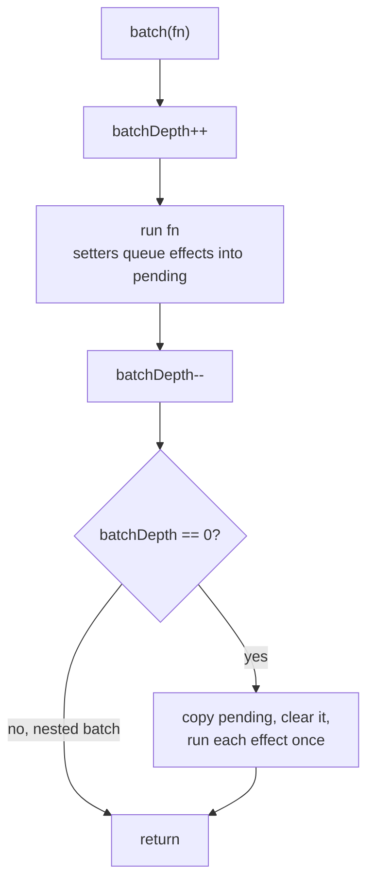

`pending` is a `Set`, so an effect that depends on three signals written in one batch runs once, not three times.

---

## 6. Ownership and cleanup

Every effect belongs to an owner. When an owner re-runs or is disposed, everything it owns is disposed first. This is what stops a removed piece of UI from still updating in the background.

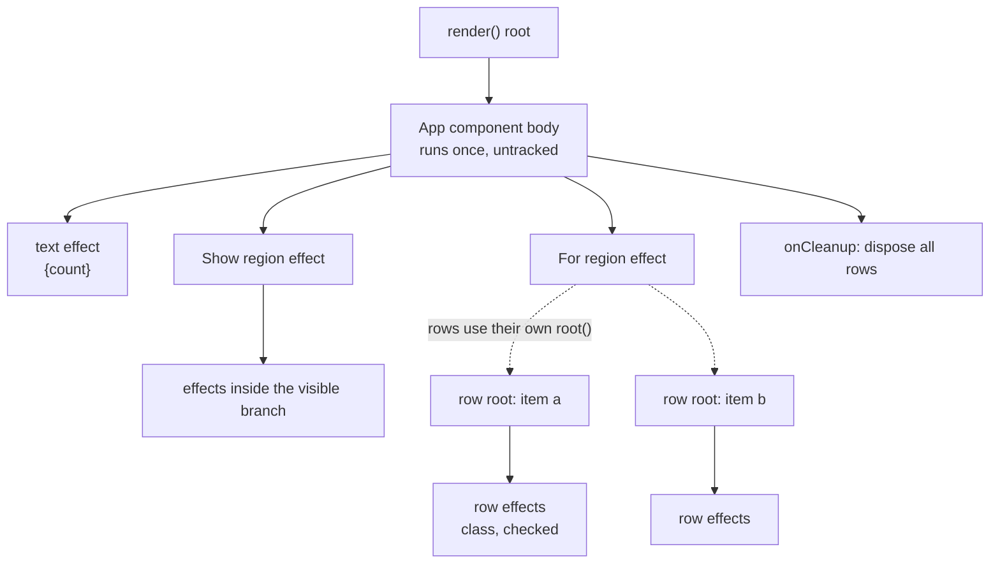

- **Effect owners.** When `Show`'s region effect re-runs, it first runs its cleanups, which dispose the effects inside the old branch.
- **Root owners.** `root(fn)` creates a scope that nobody re-runs. It is disposed only when its `dispose` is called. `render()` uses one for the whole app, and `For` uses one per row, so rows survive the list's region effect re-running.
- **`onCleanup(fn)`** registers a function on the current owner. `For` uses it to dispose all its rows when the list itself is removed.

`untrack()` vs `root()`:

| | Stops tracking? | New owner? | Used by |
| --- | --- | --- | --- |
| `untrack(fn)` | yes | no, keeps current owner | `h()` for component bodies |
| `root(fn)` | yes | yes, a new independent scope | `render()`, `For` rows |

---

## 7. Renderer

### 7.1 h(): from JSX to DOM

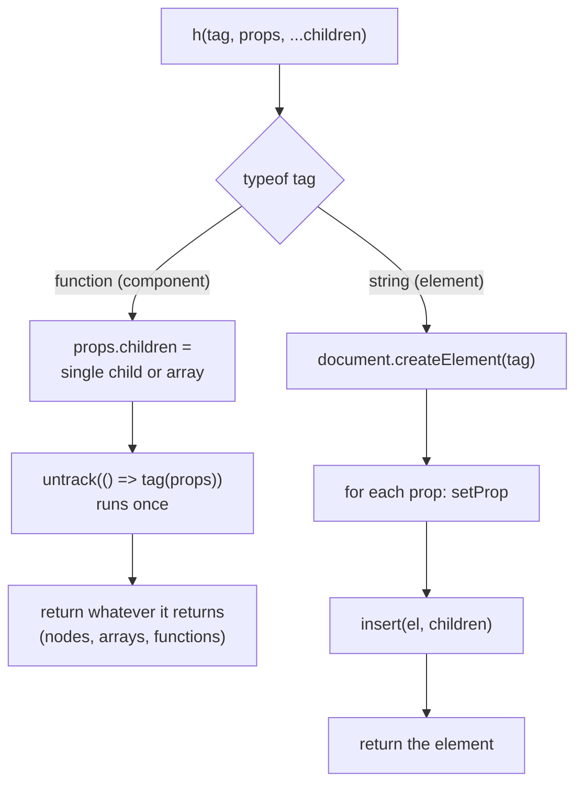

Component bodies run inside `untrack`. Without it, a component that reads a signal in its body would subscribe the *parent* effect, and the whole parent region would re-render on every change.

### 7.2 setProp: how props are applied

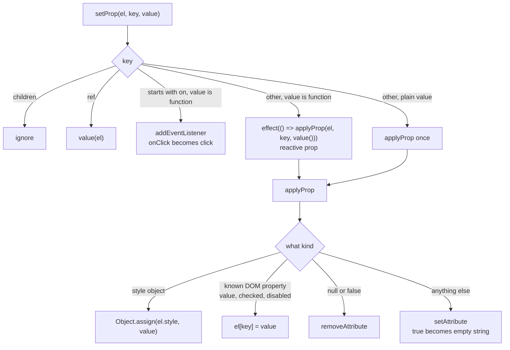

`className` is normalized to `class`. Properties are preferred over attributes when the element has one, so `value` and `checked` stay in sync with what the user typed.

### 7.3 toNodes and insert: children

`toNodes` turns any `Child` into a flat list of DOM nodes:

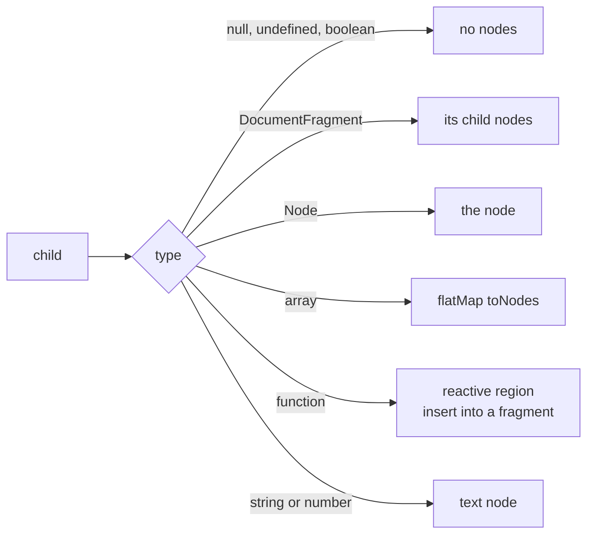

A **function child** becomes a *reactive region*: two empty comment nodes that bracket content which is rebuilt whenever the function's dependencies change.

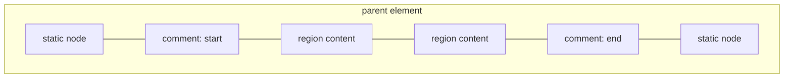

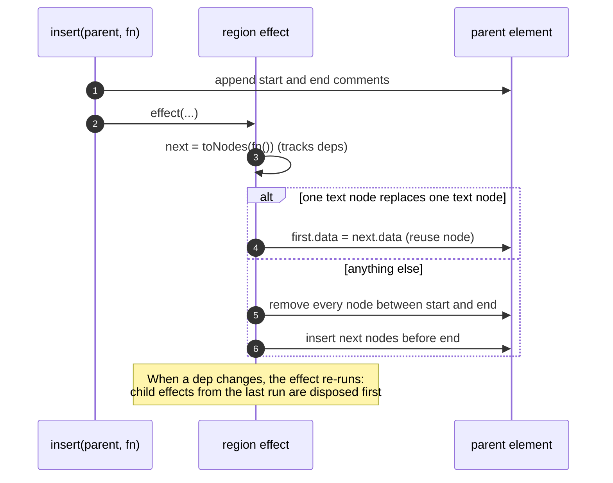

The markers make regions **nestable**. A region does not need to remember which nodes it inserted; it removes whatever is between its markers, including the nodes of any inner regions. The text fast path means `{count}` updates by changing `Text.data` on the same node, with no DOM insertions.

### 7.4 render()

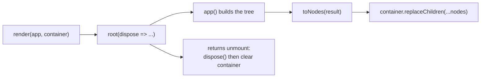

---

## 8. Control flow: Show and For

### 8.1 Show

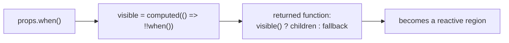

`Show` wraps the condition in `computed(!!...)`, so the region only re-renders when the condition flips between truthy and falsy, not every time the underlying value changes. `children` and `fallback` are created once when the JSX is evaluated, and moved in and out of the DOM.

### 8.2 For

`For` keeps a `Map` from item to `Row`. Rows are matched by item **identity**.

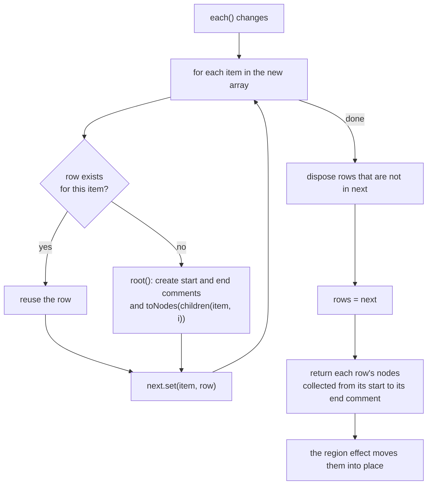

Collecting nodes between each row's markers (instead of saving a node list when the row is created) keeps rows correct even when a row contains its own reactive regions that change size.

Reordering moves existing DOM nodes. It does not re-create them, so focus, input state, and row effects survive.

---

## 9. End-to-end example: one click

What happens when you click **+** in the Counter demo:

```tsx
const [count, setCount] = signal(0);
const double = computed(() => count() * 2);
effect(() => { document.title = `Count: ${count()}`; });

<button onClick={() => setCount((c) => c + 1)}>+</button>
<strong>{count}</strong>
<p>Double: {double}</p>
<Show when={() => count() >= 5} ...>
```

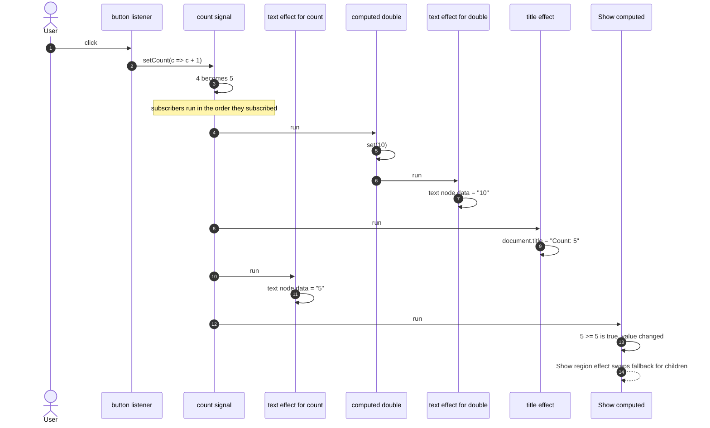

No component function runs again. Only the small effects attached to `count` and `double` run. The two text nodes are updated in place, the title changes, and the `Show` region swaps one paragraph for another.

---

## 10. Design decisions and limitations

| Decision | Why | Trade-off |
| --- | --- | --- |
| Fine-grained signals, no virtual DOM | Updates touch only the affected node. No diffing, very small code. | Components run once, so dynamic values must be written as functions (`{count}` or `{() => ...}`), not `{count()}`. |
| Synchronous effects | Easy to follow and debug: a `set` finishes all its updates before returning. | A diamond dependency can run an effect more than once per change. Use `batch()` to group writes. |
| Comment markers for regions | Regions can nest and change size without bookkeeping. | Extra comment nodes in the DOM. |
| `For` keyed by identity | No `key` prop needed; rows survive reordering. | Duplicate items in one array share a row. Primitive lists with repeats need wrapping in objects. |
| Classic JSX factory (`h`) | Works with Bun and TypeScript through `tsconfig.json` alone; no runtime package needed. | Files that use JSX must import `h` and `Fragment`. |
| Props typed as `Record<string, any>` | Keeps the framework tiny. | No autocomplete or type checking for element attributes. |

Not supported yet: SVG and MathML elements (they need `createElementNS`), context or dependency injection, async resources, server-side rendering, and error boundaries.

---

## 11. API reference

| Export | Signature | Section |
| --- | --- | --- |
| `signal` | `signal<T>(v: T): [Getter<T>, Setter<T>]` | [5.1](#51-dependency-tracking-reads), [5.2](#52-update-propagation-writes) |
| `effect` | `effect(fn: () => void \| (() => void)): () => void` | [5.3](#53-effect-lifecycle) |
| `computed` | `computed<T>(fn: () => T): Getter<T>` | [5.4](#54-computed) |
| `batch` | `batch<T>(fn: () => T): T` | [5.5](#55-batch) |
| `untrack` | `untrack<T>(fn: () => T): T` | [6](#6-ownership-and-cleanup) |
| `root` | `root<T>(fn: (dispose) => T): T` | [6](#6-ownership-and-cleanup) |
| `onCleanup` | `onCleanup(fn: () => void): void` | [6](#6-ownership-and-cleanup) |
| `h` | `h(tag, props, ...children): Child` | [7.1](#71-h-from-jsx-to-dom) |
| `Fragment` | `Component` | [7.1](#71-h-from-jsx-to-dom) |
| `render` | `render(app: () => Child, el: Element): () => void` | [7.4](#74-render) |
| `Show` | `<Show when={() => x} fallback={...}>...</Show>` | [8.1](#81-show) |
| `For` | `<For each={() => list}>{(item, i) => ...}</For>` | [8.2](#82-for) |
| `Getter`, `Setter`, `Child`, `Component` | types | [4](#4-data-model) |
